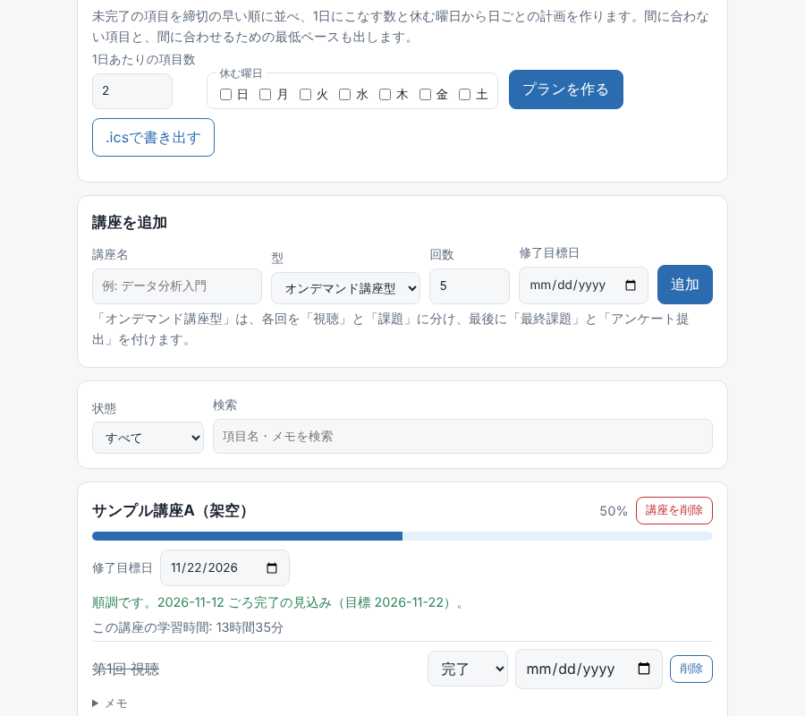
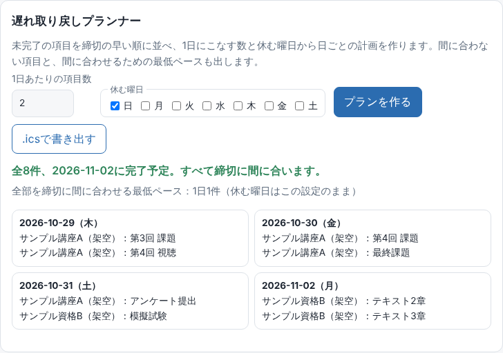
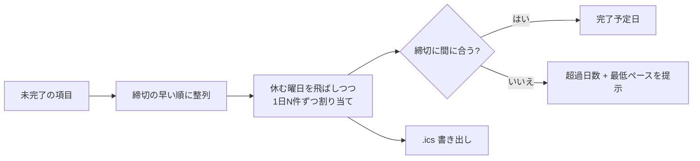

# 学習進捗トラッカー

講座・資格・自習の **進捗・学習時間・完了ペースの予測** をまとめて管理する、ブラウザだけで動くWebアプリです。ビルド不要で、`index.html` を開くだけで使えます。データはあなたのブラウザの中にだけ保存され、外部には一切送られません。



## 特徴：遅れ取り戻しプランナー
進捗アプリの多くは「どれだけ遅れているか」を見せて終わります。このアプリは **「では、どう取り戻すか」** まで出します。



- 未完了の項目を **締切の早い順** に並べ、「1日の項目数」と「休む曜日」から **日ごとの計画** を作る
- 締切に間に合わない項目を **超過日数つき** で表示し、**全部間に合わせる最低ペース**（1日N件）を計算する
- 計画を **`.ics`（iCalendar）** で書き出し、Googleカレンダー等に読み込める。カレンダーのAPIは使わず、ファイルを作るだけなので外部通信は発生しない



実装は [`planner.js`](planner.js)（画面・保存に依存しない純粋関数）と [`tests/planner.test.js`](tests/planner.test.js)。`.ics` は、項目名に含まれる改行・`;`・`,` をエスケープして **プロパティ注入を防ぎ**、75オクテットの折り返しはマルチバイト文字の途中で切りません。

## できること
| 機能 | 内容 |
|---|---|
| 講座テンプレート | 「オンデマンド講座型」を選ぶと、各回を「視聴」と「課題」に分け、最後に「最終課題」「アンケート提出」を自動作成 |
| 進捗管理 | 状態（未着手/進行中/完了）、締切、メモ。講座ごと・全体の進捗バー |
| 学習タイマー | 25分などの集中タイマー。終了すると自動で学習時間を記録（手動記録も可） |
| 学習の可視化 | 直近7日の棒グラフ、直近12週のカレンダー、連続学習日数、今週・累計の学習時間 |
| ペース予測 | 直近14日の完了ペースから終了予定日を見積もり、「順調／遅れ気味」と、間に合わせるのに必要な1日あたりの項目数を表示 |
| 遅れ取り戻しプラン | 日ごとの計画、間に合わない項目、最低ペース、`.ics` 書き出し |
| 絞り込み | 状態・キーワードで項目を検索 |
| データ管理 | JSONの書き出し／読み込み（バックアップ用）、全削除 |
| その他 | ダークモード、スマホ対応、キーボード操作、動きを減らす設定に対応 |

## プライバシーとセキュリティ
詳細は [SECURITY.md](SECURITY.md)。要点だけ：
- データは **localStorage のみ**。サーバーなし、アカウントなし、外部通信なし（CSPで外部接続を禁止）
- 描画は `textContent` / `createElement` のみで、`innerHTML` を使わない（XSS対策）
- 読み込むJSONは、型・長さ・件数・日付の実在・ID形式を検証してから採用
- リポジトリにあるサンプルは **すべて架空のデータ**。個人情報・講義資料・課題の解答は含みません

## 使い方
1. `index.html` をブラウザで開く
2. 「サンプルを読み込む」で、架空データで全機能を試す
3. 「講座を追加」で名前・型・回数・修了目標日を入れる
4. 項目の状態を更新したり、タイマーで学習時間を記録したりする

GitHub Pages で公開する場合は、Settings → Pages で `main` ブランチを選ぶだけです。

## 設計メモ
```
index.html   画面（CSPを meta で宣言）
style.css    スタイル（ライト/ダーク）
stats.js     統計ロジック。画面や保存に依存しない純粋関数（今日の日付を引数で受け取る）
store.js     保存・検証（sanitize）・講座テンプレート
planner.js   遅れ取り戻しプラン（割り当て・最低ペース・.ics生成）。純粋関数
app.js       画面の描画とイベント処理
tests/       自動テスト（統計・検証・画面・セキュリティ）
```
- **ロジックと画面を分離**: 統計は純粋関数にして、日付を固定したテストができるようにしています
- **入口で必ず検証**: localStorage もJSONも、同じ `sanitize` を通すので、壊れたデータや悪意あるデータで画面が壊れません
- **予測は単純に**: 直近14日の完了数 ÷ 14日 を1日あたりのペースとし、残り項目数から完了日を出します（遅れの判定は修了目標日、なければ最後の締切）
- **ES module を使わない理由**: `index.html` をダブルクリックしてそのまま開けるようにするため（file:// では module の読み込みが制限される）

## 開発
```
npm install
npm test     # Node 20 以上。統計・検証・画面(jsdom)・セキュリティの自動テスト
```

## ライセンス
MIT
